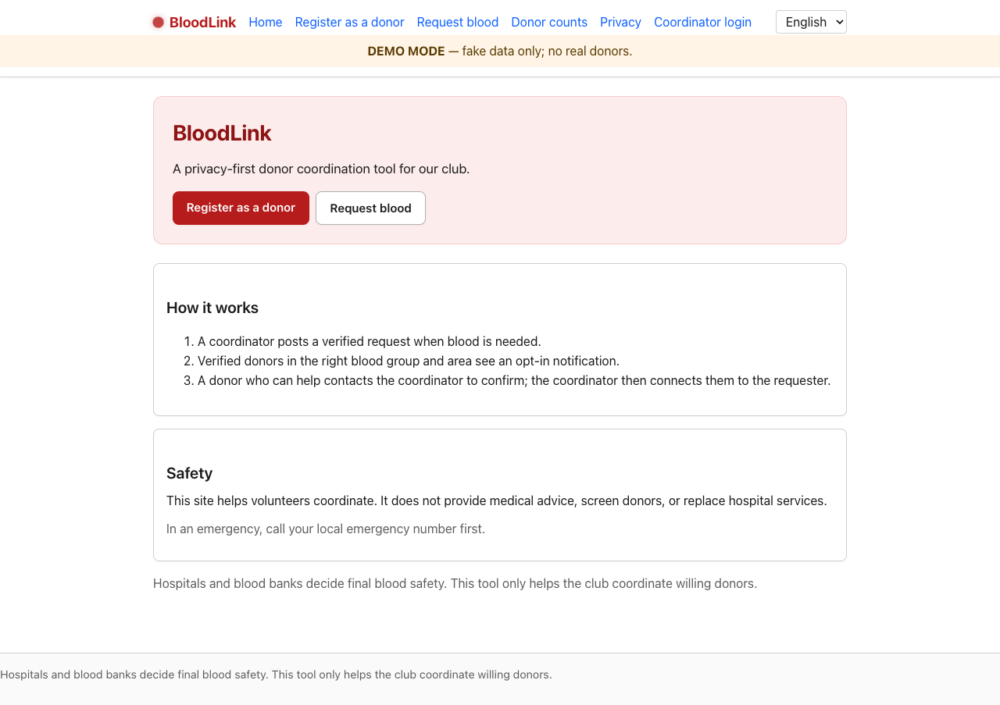
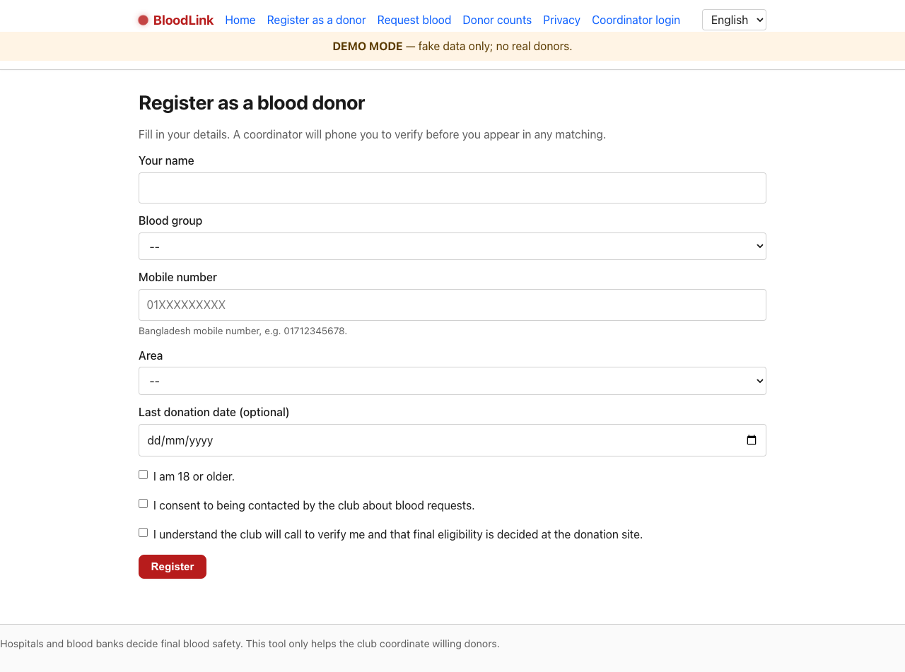
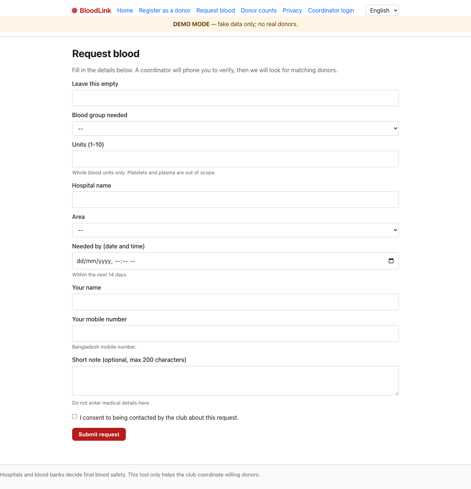
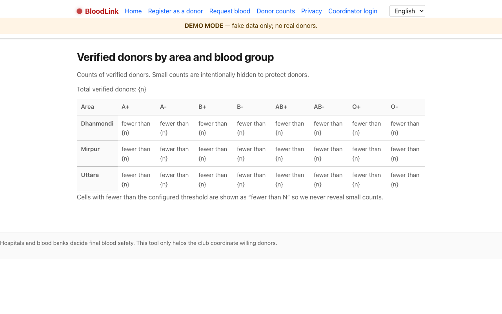
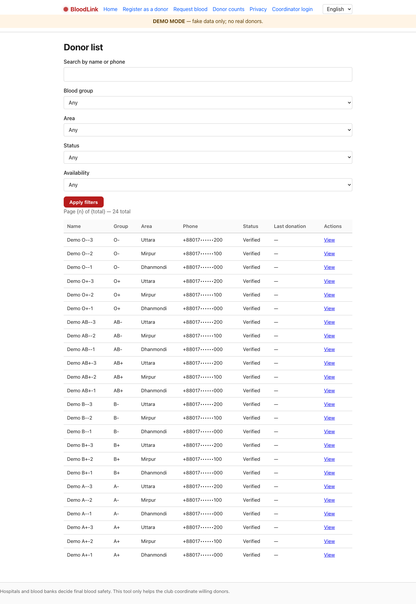
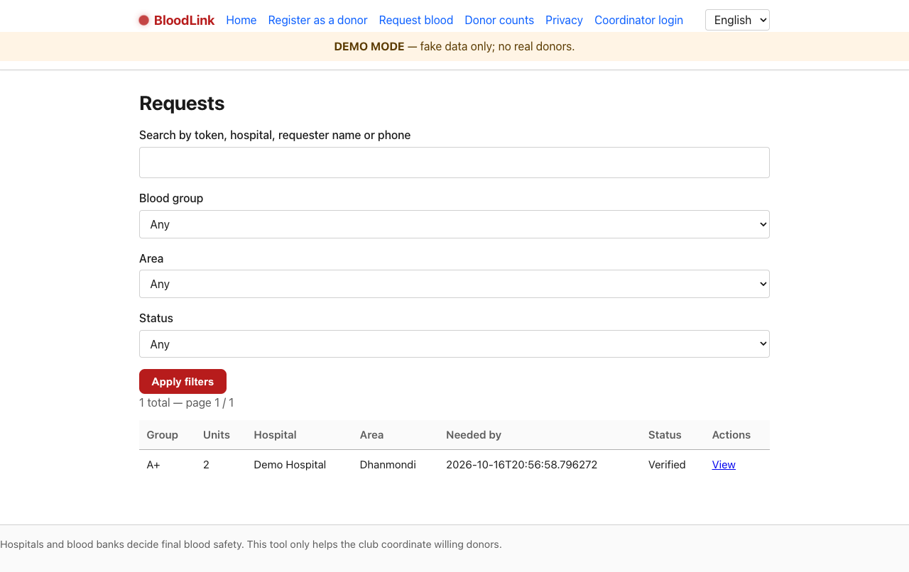
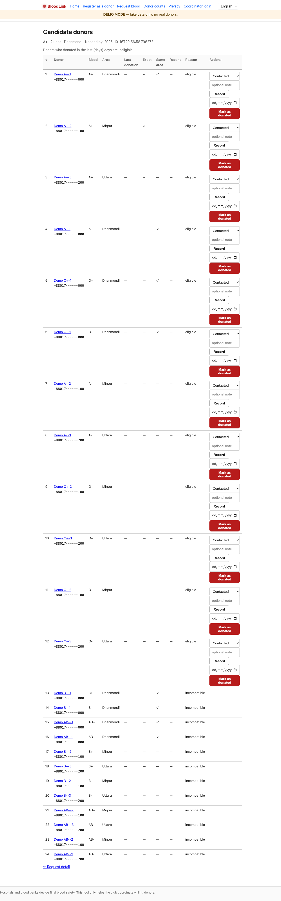
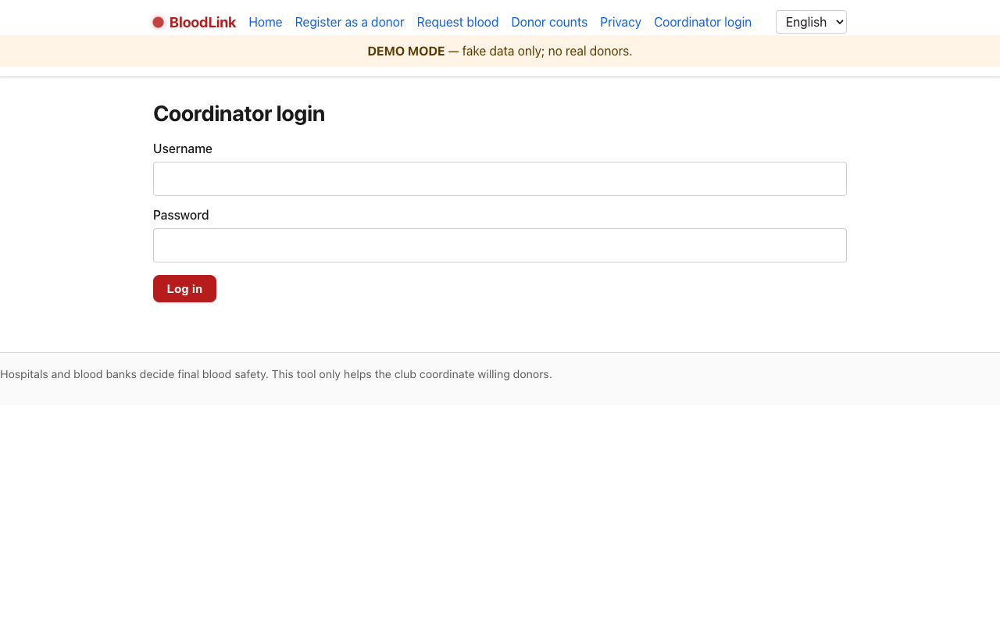

# BloodLink

A privacy-first blood-donor coordination tool for a small volunteer
club. Coordinators verify donors, requesters submit blood requests,
and the matching engine ranks compatible donors. Optional Telegram
bot for instant notifications.

* **Stack:** Python 3.12, FastAPI, SQLModel, Alembic, PostgreSQL,
  Jinja2, HTMX, pytest.
* **No JS framework.** No tracking. No third-party fonts.
* **Small.** 270+ tests, one process, one DB.

## Screenshots

| Landing & Quick Actions | Donor Registration | Request Blood Form |
| :---: | :---: | :---: |
|  |  |  |

| Public Stats & Availability | Coordinator Donors Directory | Coordinator Requests Queue |
| :---: | :---: | :---: |
|  |  |  |

| Candidate Matching Engine | Coordinator Portal Login |
| :---: | :---: |
|  |  |

## Quick start (local dev)

```bash
git clone <your-fork> bloodlink && cd bloodlink
python -m venv .venv
.venv/bin/pip install -e ".[dev]"
cp .env.example .env
.venv/bin/alembic upgrade head
.venv/bin/python -m app.cli create-coordinator coord 'dev-pass'
DEMO_MODE=true .venv/bin/uvicorn app:app --reload
```

Open <http://127.0.0.1:8000>.

## Quick start (Docker)

```bash
docker compose up --build
# In another shell: alembic upgrade + create-coordinator
docker compose exec app alembic upgrade head
docker compose exec app python -m app.cli create-coordinator coord 'dev-pass'
```

## How it works

1. **Donor signs up** at `/donor/register` (no account, no password).
   They get a tokenised manage URL emailed/printed, never published.
2. **Coordinator verifies** donors from `/coordinator/donors`. Verified
   donors are visible in matching and stats; unverified are not.
3. **Requester submits** a blood request at `/request/new`. They get
   a tokenised tracking URL.
4. **Coordinator reviews** at `/coordinator/requests`. The matching
   page (`/coordinator/matching/{rid}`) shows ranked candidates with
   reasons (compatible, eligible, same area, longest-verified first).
5. **Coordinator contacts** candidates one by one. Each call is
   recorded as a `ContactAttempt` with outcome.
6. **Donor accepts** (web) or **donor declines** (web or Telegram
   callback). The donor's manage page lets them opt out at any time.

## Security model

* **No PII in URLs.** Manage and request URLs use 192-bit random
  tokens, SHA-256 hashed in the DB.
* **No PII in the public stats page.** Counts are bucketed;
  small-number suppression is on by default.
* **CSRF on every form.** `/telegram/webhook` is exempt because it
  has its own `X-Telegram-Bot-Api-Secret-Token` header check.
* **Login rate-limited.** 5 attempts per 15 min per username+IP.
* **Request rate-limited.** 5 submissions per IP per hour; 3 active
  requests per phone.
* **CSP with no inline scripts.** HTMX is served from
  `/static/vendor/htmx.min.js`.
* **HSTS in production.** Set `ENV=production` and run behind HTTPS.
* **Production SECRET_KEY required.** The default key refuses to
  start in `ENV=production`.

See [DEPLOY.md](DEPLOY.md) for the full deployment guide and
[PILOT.md](PILOT.md) for the operator runbook.

## CLI

```bash
.venv/bin/python -m app.cli create-coordinator USERNAME PASSWORD
.venv/bin/python -m app.cli seed         # idempotent demo data
.venv/bin/python -m app.cli purge        # null PII on closed requests
.venv/bin/python -m app.cli purge --days 7
```

## Tests

```bash
.venv/bin/python -m pytest -q                # full suite (~5s, 275 tests)
.venv/bin/ruff check .                       # lint
scripts/smoke_test.sh                        # boot the app and hit every route
```

The full test suite covers 270+ tests across:

* Auth (login, logout, rate limit, generic error)
* Donor CRUD (register, verify, suspend, manage)
* Blood-request lifecycle (F5, F6: create, verify, fulfill, reject, expire)
* Matching engine (F7: 8×8 compatibility, ranking, exclusions)
* Telegram integration (F8: webhook, callbacks, idempotency)
* Stats and small-number suppression (F9)
* I18N (English + বাংলা)
* Privacy (purge, retention, audit)
* Hardening (security headers, body-size cap, no PII in logs)
* Error pages (404/500)

## Project layout

```
app/
  __init__.py        # FastAPI app factory
  config.py          # pydantic-settings
  db.py              # SQLAlchemy engine
  csrf.py            # signed-token CSRF
  session.py         # SessionMiddleware
  middleware.py      # SecurityHeaders + body-size cap
  audit.py           # append-only audit log
  matching.py        # pure matching engine
  stats.py           # pure stats computation
  purge.py           # PII retention
  templates/         # Jinja2 templates
  routes/            # FastAPI routers
  models/            # SQLModel entities
  cli/               # create-coordinator, seed, purge
  translations/      # en.json, bn.json
tests/               # pytest
scripts/             # smoke test
alembic/             # migrations
Dockerfile           # production image
docker-compose.yml   # local dev with Postgres
render.yaml          # Render blueprint
```

## License

Internal use only. See [PRIVACY.md](/privacy) (rendered at `/privacy`)
for what we collect and why.